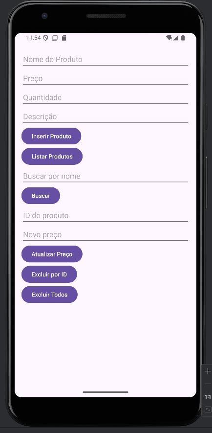
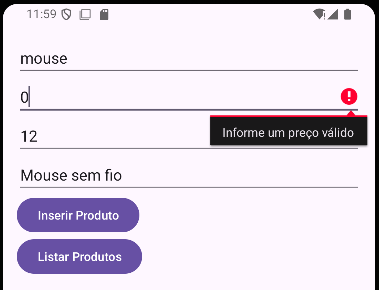
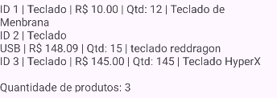
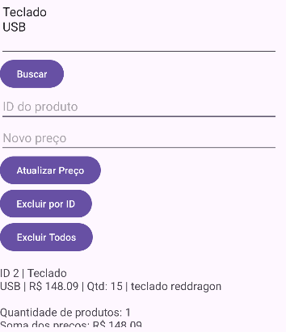
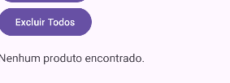
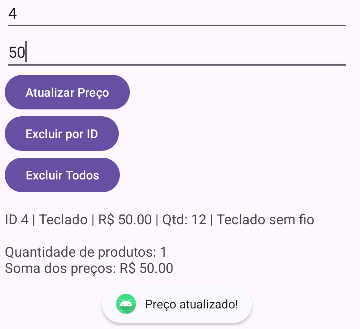
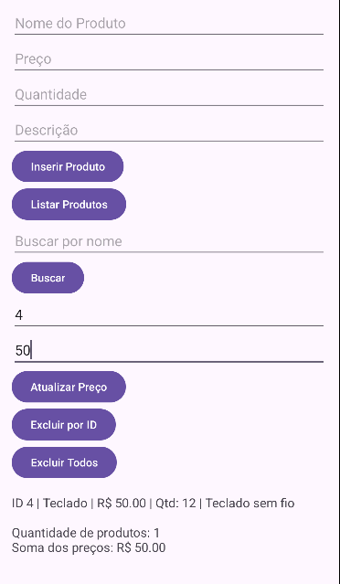

# AppRoomProduto: Cadastro de Produtos com Room SQLite

**Alunos:** Luis Leal e Enzo Alonso
**RA:** 240364 e 242713
**Disciplina:** Programação para Dispositivos Móveis
**Professor(a):** Alessandro Ferreira

## Sobre o projeto

Aplicativo Android em Kotlin que cadastra, lista, busca, atualiza e exclui produtos
usando persistência local com Room (SQLite).

## Tecnologias

- Kotlin
- Room 2.6.1 (SQLite)
- ViewBinding
- Corrotinas (lifecycleScope)

## Prints do app



---

## Parte A: Complemento prático

### A1. Limpar campos após inserir

**O que foi feito:** criei a função `limparCampos()`, chamada logo depois que o produto é inserido com sucesso. Ela apaga o texto dos campos e devolve o cursor ao campo Nome com `requestFocus()`.

**Trecho de código:**

```kotlin
private fun limparCampos() {
    binding.editProductName.text.clear()
    binding.editProductPrice.text.clear()
    binding.editProductQuantity.text.clear()
    binding.editProductDescription.text.clear()
    binding.editProductName.requestFocus()
}
```

**Print:** 

### A2. Validação de preço

**O que foi feito:** o preço é convertido com `toDoubleOrNull()`. Se estiver vazio (nulo), for zero ou negativo, o erro aparece no próprio campo e a inserção é cancelada com `return@setOnClickListener`.

**Trecho de código:**

```kotlin
val price = binding.editProductPrice.text.toString().toDoubleOrNull()

if (price == null || price <= 0) {
    binding.editProductPrice.error = "Informe um preço válido"
    return@setOnClickListener
}
```

**Print:** 

### A3. Lista na tela

**O que foi feito:** adicionei um `TextView` (`txtResultado`) abaixo dos botões. A função `mostrarLista()` monta uma linha por produto e exibe tudo nele ao clicar em Listar Produtos.

**Trecho de código:**

```kotlin
binding.btnListarProdutos.setOnClickListener {
    lifecycleScope.launch { mostrarLista(productDao.getAll()) }
}

private fun mostrarLista(products: List<Product>) {
    if (products.isEmpty()) {
        binding.txtResultado.text = "Nenhum produto encontrado."
        return
    }
    val linhas = products.joinToString("\n") {
        "ID ${it.id} | ${it.name} | R$ %.2f | Qtd: ${it.quantity} | ${it.description}".format(it.price)
    }
    binding.txtResultado.text = linhas
}
```

**Print:** 

### A4. Total do estoque

**O que foi feito:** dentro de `mostrarLista()`, mostro também a quantidade de produtos (`products.size`) e a soma dos preços (`products.sumOf { it.price }`) junto da lista.

**Trecho de código:**

```kotlin
val total = products.sumOf { it.price }
binding.txtResultado.text =
    "$linhas\n\nQuantidade de produtos: ${products.size}\nSoma dos preços: R$ %.2f".format(total)
```

**Print:** 

### A5. Buscar por nome

**O que foi feito:** criei a função `buscarPorNome()` no DAO, um campo de busca e o botão Buscar. O texto digitado é envolvido por `%` para o `LIKE` encontrar nomes parecidos.

**Trecho de código:**

```kotlin
// ProductDao.kt
@Query("SELECT * FROM product WHERE name LIKE :nome")
suspend fun buscarPorNome(nome: String): List<Product>

// MainActivity.kt
binding.btnBuscar.setOnClickListener {
    val texto = binding.editBusca.text.toString().trim()
    lifecycleScope.launch { mostrarLista(productDao.buscarPorNome("%$texto%")) }
}
```

**Print:** 

### A6. Excluir produtos

**O que foi feito:** criei `deleteAll()` e o botão Excluir Todos. No desafio extra, criei `deleteById()` e o botão Excluir por ID, que também informa se o ID não existe (a função retorna quantas linhas foram apagadas).

**Trecho de código:**

```kotlin
// ProductDao.kt
@Query("DELETE FROM product")
suspend fun deleteAll()

@Query("DELETE FROM product WHERE id = :id")
suspend fun deleteById(id: Int): Int

// MainActivity.kt
binding.btnExcluirTodos.setOnClickListener {
    lifecycleScope.launch {
        productDao.deleteAll()
        mostrarLista(productDao.getAll())
    }
}
```

**Print:** 

### A7. Atualizar produto

**O que foi feito:** o usuário informa o ID e o novo preço. O app busca o produto com `getById()`, cria uma cópia com o preço novo (`copy(price = novoPreco)`) e grava com `@Update`.

**Trecho de código:**

```kotlin
// ProductDao.kt
@Query("SELECT * FROM product WHERE id = :id")
suspend fun getById(id: Int): Product?

@Update
suspend fun update(product: Product)

// MainActivity.kt
lifecycleScope.launch {
    val produto = productDao.getById(id)
    if (produto == null) {
        Toast.makeText(this@MainActivity, "ID não encontrado", Toast.LENGTH_SHORT).show()
    } else {
        productDao.update(produto.copy(price = novoPreco))
        mostrarLista(productDao.getAll())
    }
}
```

**Print:** 

### A8. Novo campo na tabela (quantity)

**O que foi feito:** adicionei `quantity: Int` na entidade `Product`, um campo "Quantidade" no layout e aumentei a `version` do banco de 1 para 2.

**Trecho de código:**

```kotlin
// Product.kt
@ColumnInfo(name = "quantity") val quantity: Int = 0

// AppDatabase.kt
@Database(entities = [Product::class], version = 2)
```

**O que aconteceu com os produtos já cadastrados e por quê:** os produtos antigos foram apagados. Ao aumentar a versão, o Room detecta que a estrutura da tabela mudou. Como o projeto usa `fallbackToDestructiveMigration()` e não existe uma `Migration` explicando como converter a versão 1 na versão 2, o Room descarta o banco antigo e cria um novo, vazio. (Confirmei ao clicar em Listar Produtos depois da mudança: a lista veio vazia.)

**Print:** 

---

## Parte B: Questões dissertativas

### B1. O que é persistência de dados? O que aconteceria se os produtos fossem guardados apenas em uma MutableList dentro da MainActivity?

**Resposta:** Persistência de dados é a capacidade de um aplicativo guardar informações de forma que elas continuem existindo depois que o app é fechado ou o celular é reiniciado. No meu projeto, isso acontece porque o Room grava os produtos em um arquivo SQLite dentro do aparelho, chamado `database-name`. Por isso, quando fecho o app e clico em Listar Produtos de novo, os produtos cadastrados continuam lá. Se os produtos ficassem apenas em uma `MutableList` dentro da `MainActivity`, eles viveriam só na memória RAM. Assim que o app fosse fechado, o sistema matasse o processo ou até mesmo a tela fosse girada (o que recria a Activity), a lista voltaria vazia e todo o cadastro seria perdido. A lista em memória serve para dados temporários, mas não para um cadastro de produtos que precisa ser mantido.

### B2. Diferença entre SQLite direto (SQLiteOpenHelper) e Room. Cite pelo menos duas vantagens do Room.

**Resposta:** Usando o SQLite diretamente, com `SQLiteOpenHelper`, eu preciso escrever na mão o SQL de criação das tabelas, os comandos de insert e select, e converter cada linha do `Cursor` para um objeto, coluna por coluna. Isso gera muito código repetitivo e é fácil errar, por exemplo digitando o nome de uma coluna errado. O Room é uma camada por cima do SQLite que faz grande parte desse trabalho. A primeira vantagem é a verificação em tempo de compilação: se uma consulta do `@Query` estiver errada, o erro aparece ao compilar, e não com o app já rodando. A segunda é a redução de código: com `@Entity` o Room cria a tabela, e com `@Insert` ele gera o INSERT sozinho, além de converter as linhas em objetos `Product`. Uma terceira vantagem é a integração com corrotinas (`suspend`), que ajuda a não travar a tela.

### B3. Papel de Entity, DAO e Database e como se relacionam no projeto.

**Resposta:** A Entity é a classe que representa uma tabela do banco. No projeto, `Product` é a entidade: cada atributo (`id`, `name`, `price`, `description` e `quantity`) vira uma coluna, e cada objeto `Product` vira uma linha. O DAO (Data Access Object) é a interface que define os comandos que posso executar nessa tabela. O `ProductDao` tem funções como `getAll()`, `insertAll()`, `buscarPorNome()`, `deleteAll()` e `update()`, e o Room gera a implementação delas. O Database é a classe que junta tudo: o `AppDatabase` lista as entidades em `entities = [Product::class]`, define a versão e expõe o DAO pela função `productDao()`. Na `MainActivity`, eu crio o banco com `Room.databaseBuilder`, pego o DAO com `db.productDao()` e uso o DAO para ler e gravar objetos `Product`. Ou seja, a tela fala com o DAO, o DAO trabalha com a Entity, e o Database liga as duas coisas.

### B4. Por que o Android não permite acessar o banco na thread principal? O que é ANR? Como suspend e lifecycleScope.launch resolvem?

**Resposta:** A thread principal (UI thread) é a que desenha a tela e responde aos toques do usuário. Acessar o banco é uma operação de disco, que pode demorar, e se isso acontecer nessa thread a tela fica congelada até a consulta terminar. Por isso o Room bloqueia esse acesso e lança o erro "Cannot access database on the main thread". Se a thread principal ficar travada por muito tempo (cerca de 5 segundos), o Android mostra um ANR (Application Not Responding), uma mensagem dizendo que o app não está respondendo e oferecendo fechá-lo. No meu projeto, as funções do DAO são marcadas com `suspend`, o que permite ao Room executar a consulta em uma thread de fundo e devolver o resultado depois, sem bloquear a tela. O `lifecycleScope.launch` abre a corrotina que chama essas funções e a vincula ao ciclo de vida da Activity: se a Activity for fechada, a corrotina é cancelada automaticamente, evitando trabalho desnecessário e possíveis erros.

### B5. O que faz o fallbackToDestructiveMigration()? Por que é perigoso na Play Store? O que é uma Migration?

**Resposta:** O `fallbackToDestructiveMigration()` diz ao Room o que fazer quando a versão do banco muda e não existe uma migração definida: ele apaga o banco antigo e cria um novo, vazio, com a estrutura atual. Isso evita que o app quebre durante o desenvolvimento, mas todos os dados são perdidos. Eu vi isso acontecer na prática no item A8, quando aumentei a versão de 1 para 2 ao adicionar o campo `quantity`, e os produtos já cadastrados sumiram. Em um app publicado na Play Store isso é muito perigoso, porque ao atualizar o app todos os usuários perderiam seus dados, como produtos, registros ou histórico. Uma Migration é um código que ensina o Room a passar da versão antiga para a nova preservando os dados, por exemplo com um `ALTER TABLE product ADD COLUMN quantity INTEGER NOT NULL DEFAULT 0`. Em produção, o correto é escrever essas migrações em vez de apagar o banco.

### B6. Vantagem do ViewBinding em relação ao findViewById. Que tipo de erro ele evita?

**Resposta:** Com o `findViewById`, eu preciso buscar cada componente pelo id, e o resultado pode ser nulo ou do tipo errado, o que só aparece como erro quando o app já está rodando. O ViewBinding gera automaticamente uma classe de ligação para cada layout (no meu caso `ActivityMainBinding`), e com ela acesso os componentes diretamente, como `binding.editProductName`. A principal vantagem é a segurança: ele evita erros de `NullPointerException`, porque só cria referências para views que existem no layout, e evita erros de tipo (`ClassCastException`), porque cada campo já vem com o tipo certo, como `EditText` ou `Button`. Se eu digitar um id que não existe, o erro aparece na hora da compilação. Além disso, o código fica mais limpo, sem precisar declarar e buscar cada view manualmente.

### B7. Por que em apps maiores o banco deve ser Singleton? O que poderia acontecer se várias telas criassem cada uma o seu banco?

**Resposta:** No tutorial, o banco é criado dentro da `MainActivity` porque o app tem só uma tela. Em um app maior, com várias telas, o recomendado é ter uma única instância do banco para o app inteiro (Singleton), normalmente criada uma vez e reaproveitada por todas as telas. Isso é importante porque criar uma instância do banco é uma operação pesada, que abre conexões e prepara o arquivo, e fazer isso a cada tela desperdiça memória e processamento. Além disso, se cada tela criasse o seu próprio banco, poderiam existir várias conexões abertas ao mesmo arquivo ao mesmo tempo, o que pode causar conflitos de escrita, erros de bloqueio (database locked) e dados inconsistentes, já que uma tela poderia não enxergar o que a outra acabou de gravar de forma observável. Com um Singleton, todas as telas compartilham a mesma conexão e os mesmos dados.

### B8. Reflexão pessoal: principais dificuldades e como resolveu. Cite um app real em que o Room seria útil.

**Resposta:** Minha primeira dificuldade foi que o app não abria no emulador, com um erro dizendo que a `MainActivity` não estava declarada. Descobri que o `android:name` no `AndroidManifest.xml` apontava para um pacote diferente do pacote real do projeto (`br.unimes`), e o `tools:ignore="MissingClass"` estava escondendo o aviso. Resolvi corrigindo o caminho da Activity e conferindo se o `namespace` e os `import` usavam o mesmo pacote. A segunda dificuldade foi no build: apareceu um erro de metadados dizendo que a biblioteca `androidx.core` 1.17.0 exigia uma versão mais nova do Android Gradle Plugin e do `compileSdk`. Em vez de atualizar tudo, fixei uma versão mais antiga da biblioteca, compatível com o meu projeto, sincronizei o Gradle e rodei o Rebuild. Um app real em que o Room seria útil é um aplicativo de controle de estoque para um pequeno comércio: o dono cadastraria os produtos com nome, preço e quantidade, e poderia consultar, buscar e atualizar o estoque mesmo sem internet, com tudo salvo no próprio celular. Eu aplicaria a mesma estrutura deste projeto: uma entidade `Produto`, um DAO com busca e atualização de quantidade, e um banco Singleton.

-----

**Feito para fins acadêmicos**